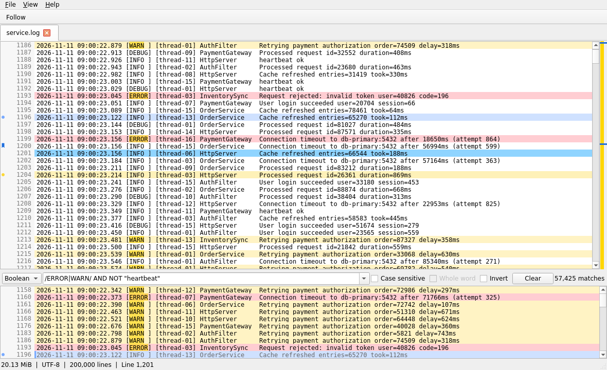

# Log Viewer

> Working title. The project will likely be renamed before its first public release.

A fast, native desktop log viewer for large text log files, written in C++23 and Qt 6 Widgets.

**Status:** feature-complete for 1.0, in hardening (milestone M7). See [docs/ROADMAP.md](docs/ROADMAP.md).

## Features

- Opens multi-gigabyte logs in a moment and scrolls smoothly; files are read from disk, never fully loaded into memory.
- Filtered view below the main view with literal, regex (PCRE2), and boolean filters (`/ERROR/ AND NOT "heartbeat"`), searched on all cores.
- Follows live logs while they are written, truncated, or rotated.
- Marks in nine colors, named bookmarks, highlight rules in sets, find, filter history, tabs, an overview bar.
- Dark mode, session restore, configurable shortcuts, single instance, several encodings.
- Windows 11 first (portable zip, no installer); Linux is built and tested in CI.
- No network access, no telemetry, no update checker.

See the [user guide](docs/USER_GUIDE.md), [docs/VISION.md](docs/VISION.md) for the scope, and [docs/SPEC.md](docs/SPEC.md) for the detailed behavior.

## Try it

Releases are published on the [releases page](https://github.com/dashonigkuchen/log-viewer/releases) once 1.0 is out. Until then, preview builds for Windows 11 (x64) come from CI:

1. Open the latest successful [CI Windows run on `main`](https://github.com/dashonigkuchen/log-viewer/actions/workflows/ci-windows.yml?query=branch%3Amain+is%3Asuccess) (requires a GitHub login).
2. Download the artifact `LogViewer-<version>-<sha>-windows-x64` (kept for 7 days) and unzip it.
3. Start `logviewer.exe`. The executable is not signed, so SmartScreen may ask: choose "More info", then "Run anyway".
4. Open a log file with `Ctrl+O`, drag and drop, or `logviewer.exe path\to\file.log`.

Put an empty `portable.ini` next to `logviewer.exe` to keep settings in that folder instead of `%APPDATA%\LogViewer`.

## How this project is built

This project is developed almost entirely by AI coding agents (mainly [Hermes Agent](https://github.com/NousResearch/hermes-agent), sometimes Claude Code). A human owner sets the direction, reviews, and tests.

The agents work through a detailed roadmap of small steps. Each step is one pull request that must pass the test suite, sanitizers, static analysis, and CI before it is merged. All rules that agents follow are in [AGENTS.md](AGENTS.md).

The code is a clean-room implementation. It contains no code from other log viewers. See [ADR 0003](docs/adr/0003-clean-room-mit-license.md).

## Documentation

| Document | Purpose |
| --- | --- |
| [docs/USER_GUIDE.md](docs/USER_GUIDE.md) | How to use Log Viewer: filters, marks, highlight rules, settings, shortcuts |
| [AGENTS.md](AGENTS.md) | Binding rules and workflow for every contributor, human or AI |
| [docs/VISION.md](docs/VISION.md) | What the product is and is not |
| [docs/SPEC.md](docs/SPEC.md) | Detailed functional specification |
| [docs/ARCHITECTURE.md](docs/ARCHITECTURE.md) | Modules, threading, data flow |
| [docs/ROADMAP.md](docs/ROADMAP.md) | Milestones and step-by-step plan |
| [docs/PERFORMANCE.md](docs/PERFORMANCE.md) | Performance budgets and how they are measured |
| [docs/DEVELOPMENT.md](docs/DEVELOPMENT.md) | Toolchain, build, test, CI, release |
| [docs/HANDOFF.md](docs/HANDOFF.md) | Current state and notes for the next session |
| [docs/adr/](docs/adr/README.md) | Architecture decision records |

## License

[MIT](LICENSE). Qt is used under the LGPL v3 and is linked dynamically.
