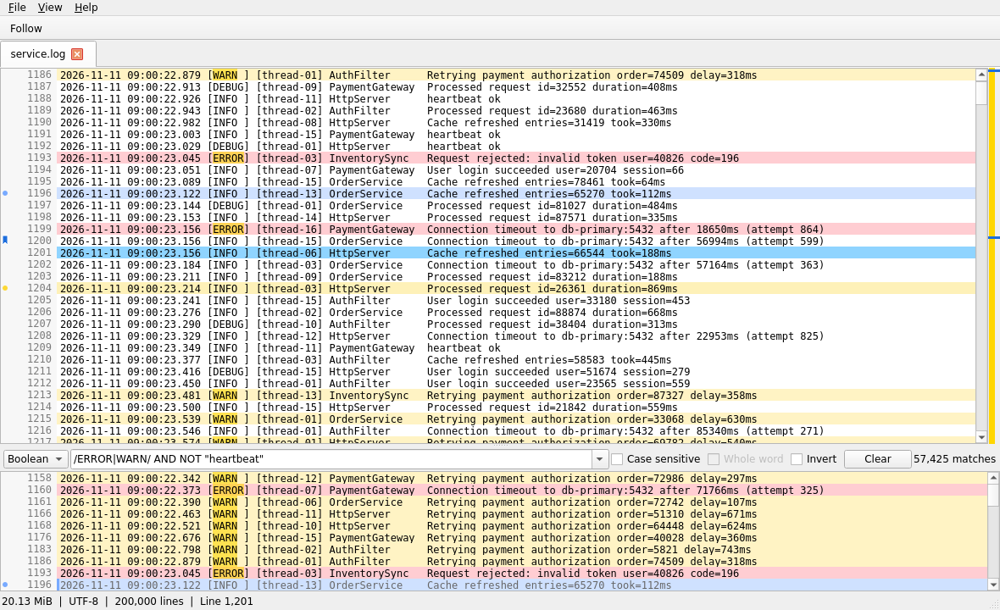
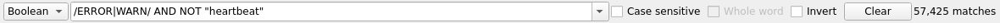
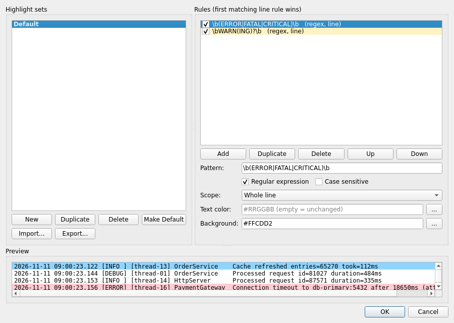

# Log Viewer user guide

Log Viewer is a fast viewer for large text log files. It reads files directly from disk, so even
multi-gigabyte logs open in a moment and scroll smoothly. It never accesses the network.

## Getting started

1. Unzip `LogViewer-<version>-windows-x64.zip` to any folder and start `logviewer.exe`. There is
   no installer. The program is not code-signed yet, so SmartScreen may warn on the first start:
   choose **More info**, then **Run anyway**.
2. Open a file with **File > Open…** (`Ctrl+O`), by dragging it onto the window, from
   **File > Recent Files**, or from the command line (`logviewer.exe path\to\file.log`).
3. Each file opens in its own tab. The tab title shows the file name; hover it for the full path.
   Right-click a tab for **Copy Full Path**, **Open Containing Folder**, **Reload**, and closing
   tabs.

## The window



- **Main view** (top): all lines of the file with line numbers. A narrow **overview bar** on its
  right shows the visible range, filter matches, marks, and bookmarks over the whole file; click
  or drag in it to jump there.
- **Filtered view** (bottom): only the lines that match the filter, with their original line
  numbers. The splitter between the two views can be dragged; its position is remembered.
- **Status bar**: line count, encoding, file size, and messages (for example when a file was
  truncated or rotated).

Clicking a line in one view selects the same line (or the nearest match) in the other view.

### Navigation

| Keys | Action |
| --- | --- |
| Arrow keys, `PgUp`, `PgDn` | Move the current line |
| `Home` / `End` | Scroll to the start / end of the line horizontally |
| `Ctrl+Home` / `Ctrl+End` | First / last line (`Ctrl+End` also turns on follow mode) |
| `Ctrl+G` | Go to line |
| `Ctrl+Tab` / `Ctrl+Shift+Tab` | Next / previous tab |
| `Ctrl++` / `Ctrl+-` / `Ctrl+0` | Zoom in / out / reset |

Select text with the mouse (double-click selects a word, triple-click a line) and copy it with
`Ctrl+C`. Lines longer than the configured maximum are cut in the display; a marker shows that.

## Filtering

Type a filter above the filtered view and press `Enter`. Changing the mode or an option applies
the filter again at once. Filtering runs in the background on all CPU cores; the status next to
the field shows the progress and the number of matches, and results appear while it runs.
**Stop** (or `Escape` in the field) ends a running search; the matches found so far stay.



Modes:

- **Literal**: the text as typed. Options: **Case sensitive**, **Whole word**.
- **Regex**: Perl-compatible regular expressions (PCRE2), for example `(ERROR|WARN).*timeout`.
- **Boolean**: terms combined with `AND`, `OR`, `NOT`, and parentheses (see below).

**Invert** shows the lines that do *not* match. Matched text is highlighted in both views. A syntax
error is shown in red with its position; the previous result stays visible.

Previous filters are kept in the history (the drop-down at the left of the field, or `Up`/`Down`
in the field). Select an entry and press `Delete` to remove it; **View > Clear Filter History**
and **Clear Filter History** in the settings remove all. `Escape` leaves the field. `Ctrl+Shift+F` jumps to the filter field.

### Boolean expressions

A term is either a quoted literal `"text"` or a regex `/pattern/`. Terms are combined with `AND`,
`OR`, `NOT` (case-insensitive keywords), and parentheses. `NOT` binds strongest, then `AND`, then
`OR`.

| Expression | Matches lines that… |
| --- | --- |
| `"ERROR" AND "database"` | contain both words |
| `"ERROR" OR "FATAL"` | contain either word |
| `/ERROR/ AND NOT "heartbeat"` | contain ERROR but not heartbeat |
| `("timeout" OR "refused") AND /user=\d+/` | contain timeout or refused, and a user ID |
| `/error/i` | contain "error" in any case (`i` after a regex term) |
| `NOT "DEBUG"` | do not contain DEBUG |

Inside a literal write `\"` for a quote and `\\` for a backslash; inside a regex write `\/` for a
slash. Plain words without quotes are an error (write `"word"`). Only positive terms are
highlighted.

### Marked lines in the filtered view

With **View > Show Marks in Filtered View** (default on), marked lines also appear in the filtered
view, dimmed and with their mark, even if they do not match.

## Find

`Ctrl+F` opens the find bar for the view that has the focus. `F3` / `Shift+F3` (or `Enter` /
`Shift+Enter` in the field) find the next / previous match; the search runs through the whole file
and wraps around with a notice. Options: case sensitive, whole word, regex. All matches on screen
are highlighted. `Escape` closes the bar.

## Marks and bookmarks

Marks and bookmarks belong to the file: both views show them, and they are saved per file and
restored when you open it again (as long as the file was not replaced in the meantime).

**Marks** highlight lines with a colored background.

| Keys | Action |
| --- | --- |
| `M` or click in the mark column | Toggle the mark on the current (or selected) lines |
| `Ctrl+1` … `Ctrl+9` | Mark in one of nine colors |
| `Ctrl+Down` / `Ctrl+Up` | Next / previous mark |

The context menu has **Copy Marked Lines** and **Clear All Marks…**.

**Bookmarks** are named positions, listed in the **Bookmarks** panel (`Ctrl+Shift+B`).

| Keys | Action |
| --- | --- |
| `Ctrl+B` | Toggle a bookmark on the current line (named after the line text) |
| `F2` / `Shift+F2` | Next / previous bookmark |

In the panel, double-click a bookmark to jump to it; right-click it and choose **Rename** to change its name.

If a file is truncated or replaced (log rotation), its marks and bookmarks are cleared and a notice
says how many were lost.

## Highlight rules

Highlight rules color lines or matches automatically, for example errors in red. Rules are grouped
into **highlight sets**; each tab uses one set (**View > Highlight Set**), the default set unless
you choose another.

**View > Edit Highlight Rules…** opens the editor:



- A rule has a pattern (literal or regex), case sensitivity, a scope (**whole line** or **match
  only**), text and background colors, and an enabled flag.
- Rules are applied in order: for whole lines the first matching rule wins; match-only rules are
  painted on top. Drag rules or use **Up** / **Down** to reorder them.
- Sets can be created, duplicated, renamed, deleted, and imported or exported as JSON.
- The preview at the bottom shows the effect on sample lines.

To create a rule quickly, select text in a view, right-click, and choose **Highlight This Text**.

## Live logs (follow mode)

Open files are watched. When a file grows, new lines appear within a fraction of a second, and the
filter is updated too.

- **Follow** (`F10` or the toolbar button) keeps both views at the end as lines arrive. Scrolling up
  turns it off; `Ctrl+End` turns it on again.
- **Truncated** files (for example after `Clear-Content`) are read again from the start.
- **Rotated** files (renamed and replaced by a new file with the same name) are reopened.
- **Deleted** files keep their content visible; the tab is reloaded when the file reappears.
- A last line that is still being written is shown and updated when it is complete.

**File > Reload** (`F5`) reads the file again from the start.

## Encodings

The encoding is detected automatically: a byte order mark (UTF-8, UTF-16 LE/BE) if there is one;
otherwise UTF-8 if the start of the file is valid UTF-8; otherwise Windows-1252. The status bar
shows the encoding. **View > Encoding** overrides it per tab: UTF-8, UTF-16 LE/BE, Windows-1252,
ISO-8859-1, Windows-1250 (Central European), Windows-1251 (Cyrillic), ISO-8859-15.

Invalid bytes are shown as `�`; control characters (including NUL in binary files) as visible
symbols like `␀`.

## Settings

**File > Settings…** (`Ctrl+,`):

| Setting | Meaning |
| --- | --- |
| Font, font size, tab width | Display of the log text (a fixed-pitch font by default) |
| Show line numbers | Line number column |
| Max line length | Characters shown per line before it is cut (the full line is still searched) |
| Theme | **System** follows Windows; **Light** or **Dark** force a scheme |
| Current line, marks, filter matches | Colors as `#RRGGBB` or `#AARRGGBB`; empty = default for the theme |
| Check files every | Polling interval for file changes (default 250 ms, 100–10,000 ms) |
| Filter history | Number of remembered filters; **Clear Filter History** empties it |
| Restore open files at startup | Reopen the tabs of the last session with position, filter, and follow mode |
| Open files in the running window | A second start opens its files as tabs in the running window |
| Search threads | 0 = all cores; takes effect at the next start |

**File > Keyboard Shortcuts…** lists all menu commands. Select one, press the new key combination,
or clear it; **Reset** / **Reset All** restore the defaults. Shortcuts used twice are listed and
must be resolved before saving. Next / previous mark (`Ctrl+Down` / `Ctrl+Up`) are commands too.
Keys inside the log view (`M`, `Ctrl+1`…`9`, arrow keys) are fixed.

### Where settings are stored

Settings, highlight sets, filter history, recent files, the session, marks and bookmarks, the
application log (`logviewer.log`), and crash dumps are stored in `%APPDATA%\LogViewer`.

**Portable mode**: create an empty file `portable.ini` next to `logviewer.exe`. Everything is then
stored in that folder instead, for example on a USB stick.

If the settings file is damaged, it is reset and the old file is kept as a backup; a message in
the status bar names it.

## Command line

```text
logviewer [options] [files...]

  files               Log files to open
  --follow            Open the files in follow mode
  --line N            Go to line N of the first file
  --new-instance      Start a new window instead of using a running one
  --help, --version
```

With "Open files in the running window" enabled, `logviewer file.log` while Log Viewer runs opens
the file as a new tab there and exits at once. This also applies to double-clicking files in
Explorer if Log Viewer is the associated program.

## Privacy and crashes

Log Viewer never accesses the network: no telemetry, no update checks. If it crashes, a small
diagnostic file (minidump, without file contents) is written to `%APPDATA%\LogViewer\dumps`; at most
five are kept. Nothing is uploaded; you may attach a dump to a bug report.

## Keyboard reference

| Keys | Action |
| --- | --- |
| `Ctrl+O` | Open file |
| `F5` | Reload |
| `Ctrl+W` | Close tab |
| `Ctrl+,` | Settings |
| `Alt+F4` | Exit |
| `Ctrl+Tab` / `Ctrl+Shift+Tab` | Next / previous tab |
| `Ctrl+Shift+F` | Focus the filter field |
| `Ctrl+F`, `F3`, `Shift+F3` | Find, next, previous |
| `Ctrl+G` | Go to line |
| `F10` | Follow mode |
| `M`, `Ctrl+1`…`9` | Toggle mark, mark in a color |
| `Ctrl+Down` / `Ctrl+Up` | Next / previous mark |
| `Ctrl+B`, `F2`, `Shift+F2` | Toggle, next, previous bookmark |
| `Ctrl+Shift+B` | Bookmarks panel |
| `Ctrl++`, `Ctrl+-`, `Ctrl+0` | Zoom |
| `Ctrl+C`, `Ctrl+A` | Copy, select all |

Menu shortcuts can be changed in **File > Keyboard Shortcuts…**.
